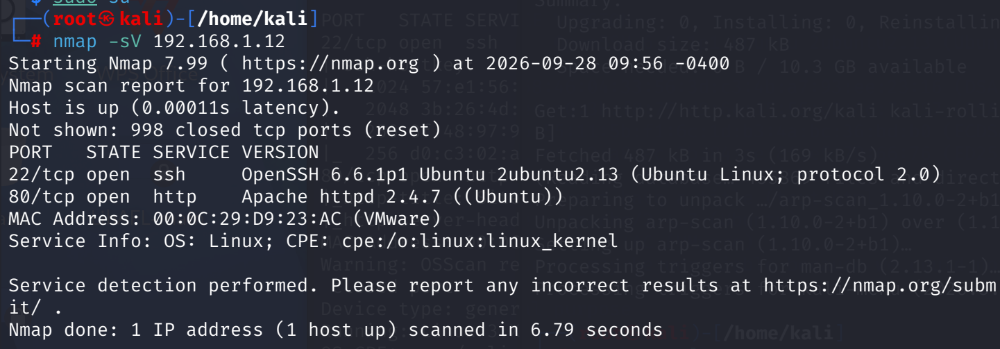
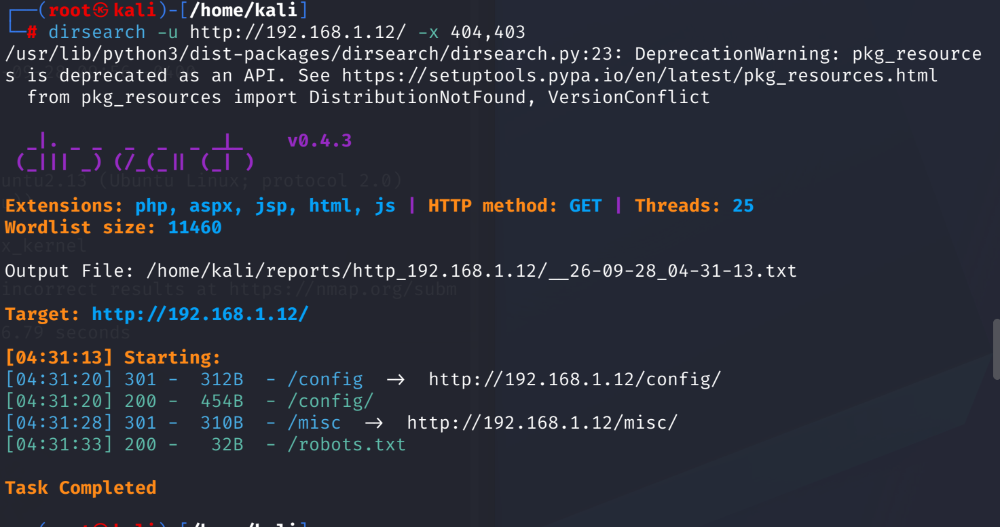
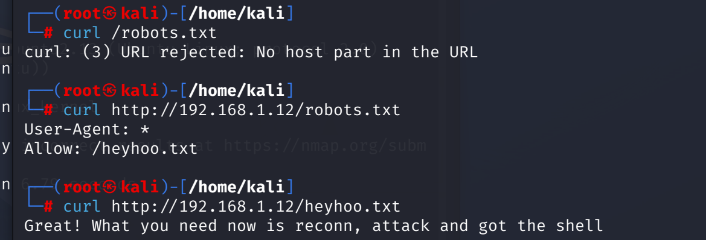
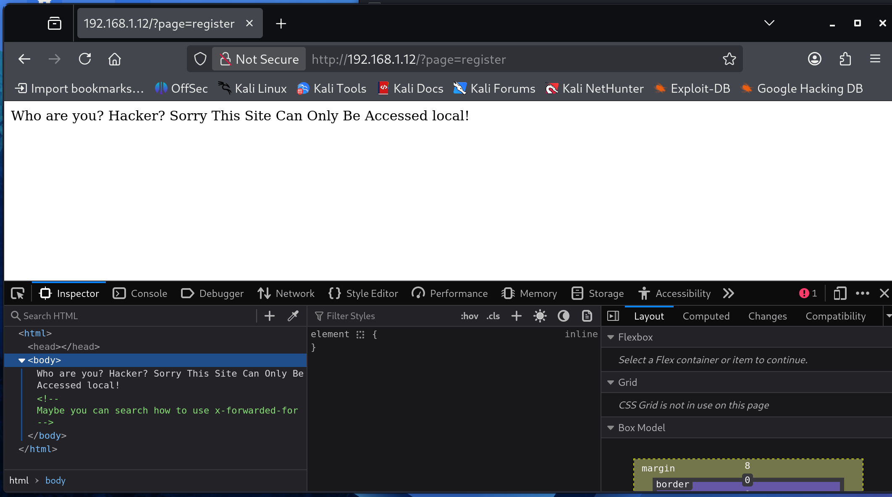
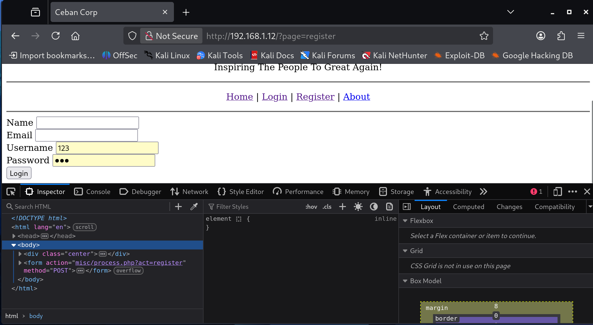
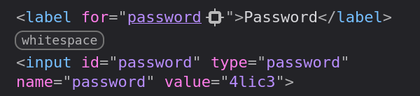
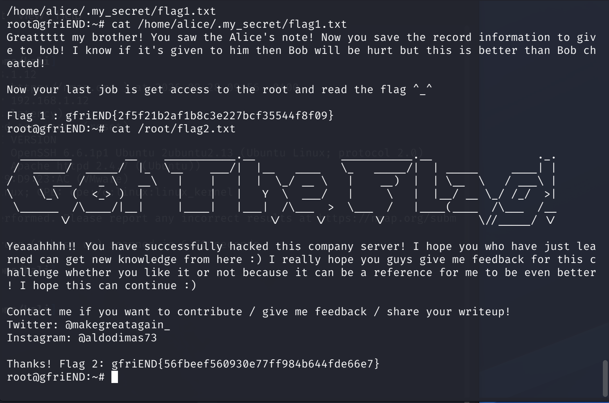

# VulnHub — Me and My Girlfriend 1 通关记录

> 网络安全课程作业 · 靶机渗透测试全过程记录
>
> 攻击链:Nmap 端口探测 → 目录扫描 → robots.txt 信息收集 → XFF 伪造本地访问 → 注册账号 → IDOR 越权获取密码 → SSH 登录 → sudo 提权 →拿到 flag

## 实验环境

- 靶机:VulnHub *Me and My Girlfriend: 1*(目标主机 alice)
- 攻击机:Kali(或任意带 nmap / dirsearch / ssh 的 Linux)

---

## 第一步:端口扫描

Nmap 扫描 alice 的主机:

发现开放了 **22、80** 端口。

## 第二步:目录扫描

看到了 80 端口,怀疑有 Web 服务,上 dirsearch:

## 第三步:查看 robots.txt

根据 dirsearch 返回的结果,找 `/robots.txt` 看看里面内容:

## 第四步:访问网页

查看目标 IP 的网页:

## 第五步:XFF 绕过本地登录限制

因为它提示说需要本地登录,考虑 **XFF(X-Forwarded-For)攻击**:

## 第六步:注册账号

注册个账号,挨个试页面内容。

## 第七步:IDOR 越权

发现了登录账号里可以看到密码,尝试**越权(IDOR)**,改 `id` 参数去看密码是否有返回。

## 第八步:拿到 alice 的密码

返回了密码 **`alic3`**:

## 第九步:SSH 登录

根据密码,猜测同密码去连接 SSH(因为开着 22 端口)。

## 第十步:查看当前权限

登录成功,执行 `sudo -l` 了解一下当前权限信息。

## 第十一步:提权到 root

提权到 root 账户:

## 第十二步:拿 flag

查看本机文件,拿到 flag。至此结束。

---

## 总结

| 阶段 | 手段 | 结果 |
|------|------|------|
| 信息收集 | nmap / dirsearch / robots.txt | 发现 22、80 端口及隐藏路径 |
| 访问控制绕过 | 伪造 X-Forwarded-For 头 | 绕过"仅本地登录"限制 |
| 漏洞利用 | IDOR 越权(改 id 参数) | 获得 alice 密码 `alic3` |
| 横向进入 | SSH 复用密码 | 登录 alice 账户 |
| 权限提升 | sudo -l 发现可滥用命令 | 提权至 root,拿到 flag |
